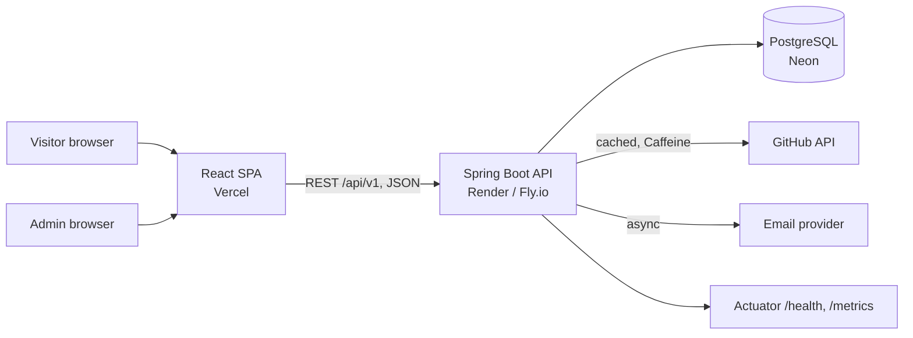

# Architecture

## Style: layered, feature-based modular monolith

One Spring Boot application, one PostgreSQL database, one React SPA. Each backend feature
(`project`, `skill`, and later `github`, `contact`, `auth`) owns its controller, service, repository, DTOs and entities.
See [ADR 0001](adr/0001-modular-monolith.md) for why this is not microservices.

## Target architecture

The diagram shows where the project is heading. Today the backend, the database and the Docker setup exist; the frontend, the GitHub integration, email and public hosting are planned (see the status tables below).

## Request flow (public project list)

`GET /api/v1/projects` -> Controller (binds `page` and `size`) -> Service (clamps them, applies the published-only rule, maps entities to DTOs inside a read-only transaction) -> Repository (Spring Data JPA) -> PostgreSQL.
Entities never leave the service layer; controllers only see DTOs.

## Cross-cutting concerns

| Concern | Approach | Status |
|---|---|---|
| Errors | `@RestControllerAdvice` returning RFC 9457 Problem Details | Implemented |
| Schema changes | Flyway only; Hibernate `ddl-auto=validate` | Implemented |
| Config | Environment variables (12-factor); Spring profiles `dev`, `test`, `prod` | Environment variables implemented; profiles planned |
| Testing | Unit (Mockito), slice (`@WebMvcTest`, `@DataJpaTest`), integration (Testcontainers) | Implemented |
| Containers | Multi-stage Docker image, Docker Compose with PostgreSQL | Implemented |
| CI/CD | GitHub Actions | In progress |
| Validation | Bean Validation on every request DTO | Planned (only read endpoints exist so far) |
| Security | BCrypt, short-lived JWT, `/api/v1/admin/**` secured, CORS limited to the frontend origin | Planned |
| Observability | Actuator + Micrometer, public `/status` page | Health endpoint implemented; metrics and `/status` planned |

## API surface (v1)

| Method | Path | Access | Status |
|---|---|---|---|
| GET | `/api/v1/projects`, `/api/v1/projects/{slug}` | Public | Implemented |
| GET | `/actuator/health` | Public | Implemented |
| GET | `/api/v1/skills` | Public | Planned |
| POST | `/api/v1/contact` | Public, rate limited | Planned |
| GET | `/api/v1/github/stats` | Public, cached | Planned |
| POST | `/api/v1/auth/login` | Public | Planned |
| POST/PUT/DELETE | `/api/v1/admin/projects/**`, `/api/v1/admin/skills/**` | Admin (JWT) | Planned |
| GET | `/api/v1/admin/messages` | Admin (JWT) | Planned |
