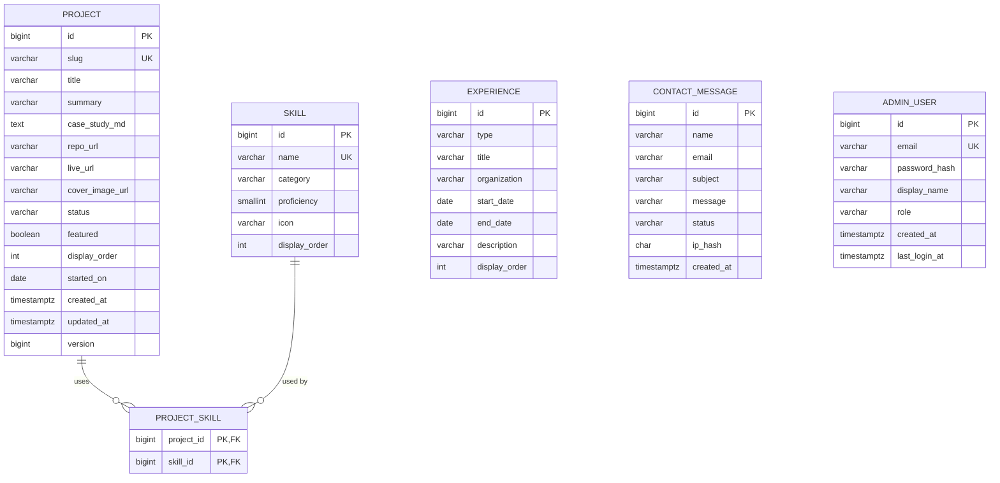

# Database schema

PostgreSQL, managed with Flyway. The source of truth is the migrations in
[`backend/src/main/resources/db/migration`](../backend/src/main/resources/db/migration):
`V1__init.sql` and `V2__experience.sql`.

## ER diagram

`experience`, `contact_message` and `admin_user` are intentionally standalone: no foreign keys link them to the content tables.

## Tables

| Table | Purpose | Notes |
|---|---|---|
| `project` | Portfolio projects and Markdown case studies | `slug` is the public URL id; `status` is DRAFT / PUBLISHED / ARCHIVED |
| `skill` | Technologies used | `category` groups them on the Skills section; `proficiency` is 1 to 5 |
| `project_skill` | Join table (many-to-many) | Composite primary key, cascade delete |
| `experience` | Work, education, certification and volunteering timeline | `type` is limited by a CHECK; `end_date` is empty or not before `start_date` |
| `contact_message` | Messages from the contact form | `ip_hash` instead of raw IP for privacy |
| `admin_user` | Admin CMS login | BCrypt hash only |

## Design decisions

1. **Identity BIGINT keys.** Simple, index-friendly and the standard choice for a single database. UUIDs would add size with no benefit here.
2. **Slug as public identifier.** URLs read `/projects/devfolio`, and the numeric id stays internal. A CHECK constraint enforces the slug format.
3. **Status column, not delete.** Drafts stay hidden from the public API and archived projects keep their history.
4. **`version` column.** Supports JPA `@Version` optimistic locking, so two admin tabs cannot silently overwrite each other.
5. **CHECK constraints for enums.** The database rejects bad values even if application code has a bug. In Java they are mapped to enums with `@Enumerated(EnumType.STRING)`, never `ORDINAL`, so reordering constants cannot corrupt existing rows.
6. **Composite PK on `project_skill`.** Prevents duplicate pairs without needing an extra id. The extra index on `skill_id` speeds up "projects using skill X" filters.
7. **Hashed IP.** Enough for rate limiting and abuse checks, without storing personal data.
8. **`TIMESTAMPTZ` for timestamps.** Avoids time zone bugs. `DATE` is used where only a calendar day matters (`started_on`, experience dates).
9. **No seed admin in the migration.** Credentials come from environment variables at startup, never from Git.
10. **Case study stored as Markdown text.** Easy to edit in the admin CMS and render on the frontend; Mermaid blocks work for free.
11. **Applied migrations are immutable.** Flyway stores a checksum of each applied migration and refuses to start if one changes. Every schema change is a new versioned file (`V3__...`), so all environments end up with the same schema.

## Implementation notes

- **`updated_at`:** the database sets a default on insert only, so Hibernate refreshes it on update with `@UpdateTimestamp`. `created_at` uses `@CreationTimestamp`.
- **Schema validation:** `spring.jpa.hibernate.ddl-auto=validate`. The application refuses to start if an entity does not match the schema. Hibernate never changes the schema; Flyway does.
- **Constraints are tested on real PostgreSQL** with Testcontainers (unique slug, unique skill name, `proficiency` range, valid project status).

## Planned later migrations

- `V3__page_view.sql`: privacy-friendly analytics (path, day, count; no personal data).

## Mapping to JPA

- `Project` has a lazy `@ManyToMany` `Set<Skill>` through `project_skill`, with no cascade, so deleting a project can never delete a skill shared with other projects.
- **N+1 queries:** the list endpoint uses Hibernate batch fetching (`hibernate.default_batch_fetch_size`) so the skills of a whole page load in one extra query. A collection fetch combined with pagination would make Hibernate paginate in memory, so the list does not use a fetch join. The detail endpoint returns one project and uses an `@EntityGraph` for its skills.
